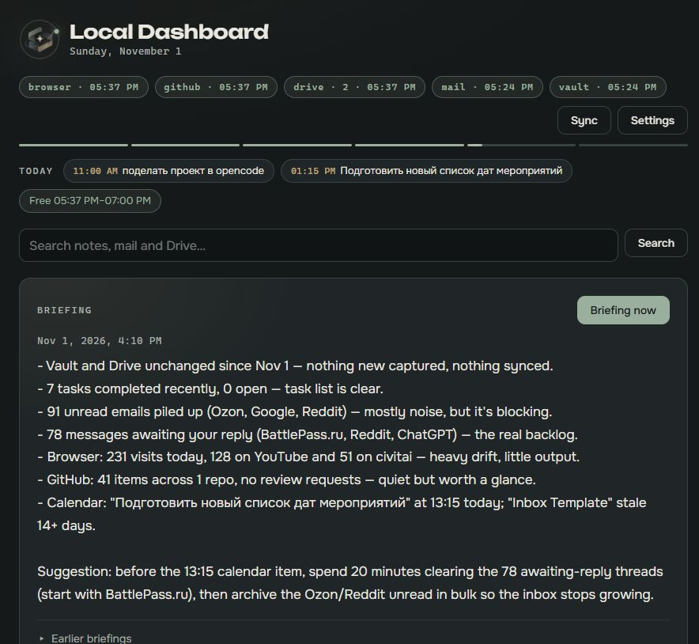
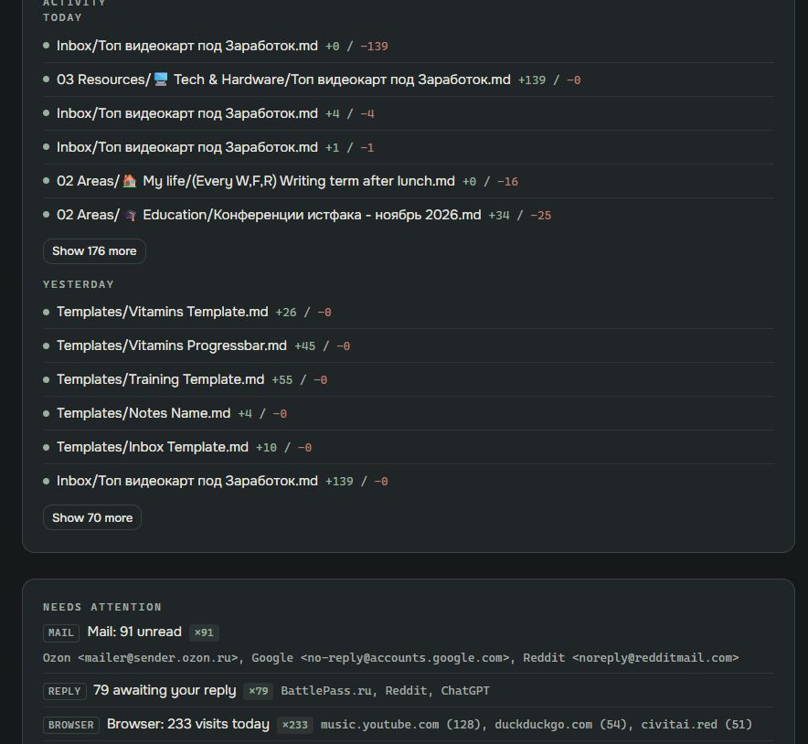
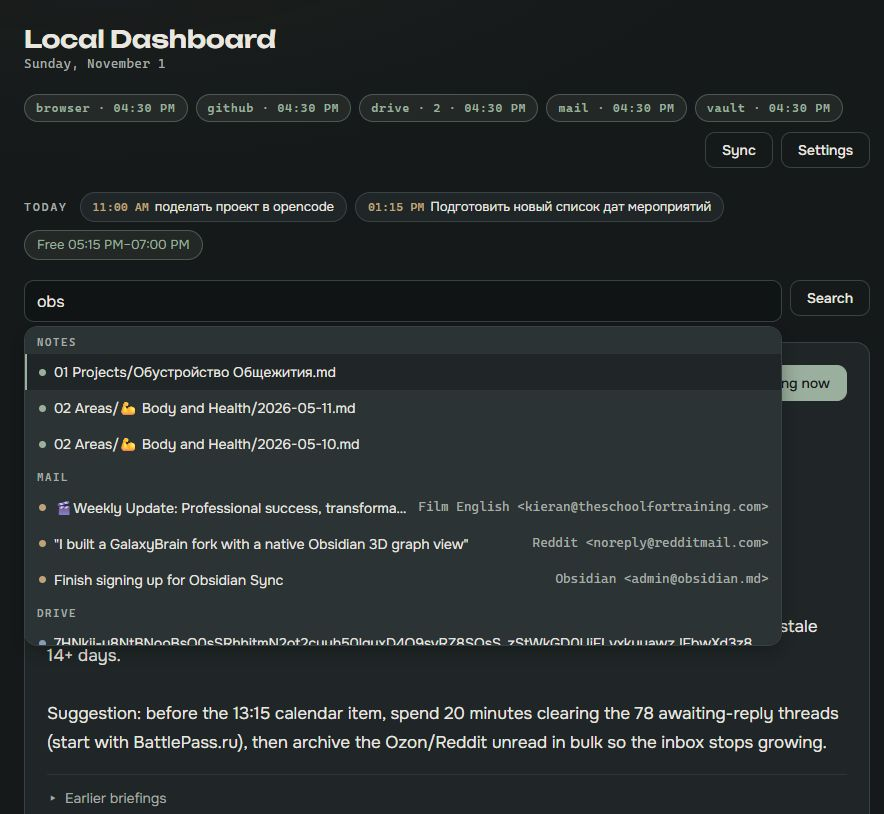
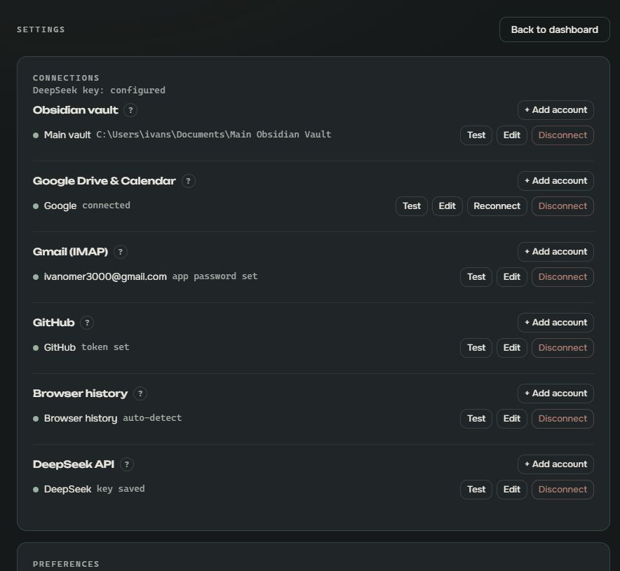
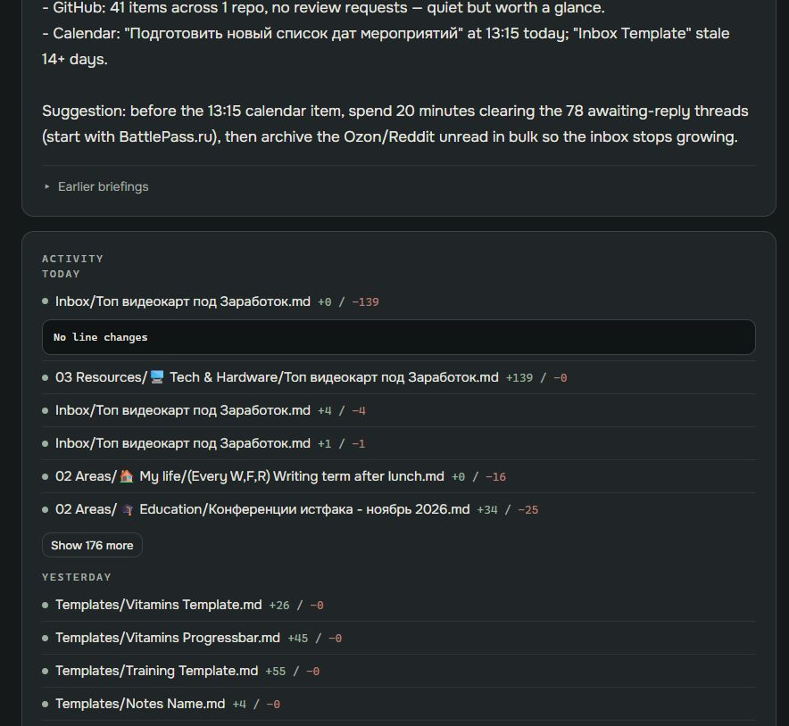

# Local Dashboard

**One quiet screen that answers two questions: what changed lately, and what needs me now.**

Local Dashboard reads your notes, mail, calendar, Drive, GitHub and browser history, keeps a
local history of what moved, and turns it into a short daily briefing written by DeepSeek.
Everything runs on your own machine. Only a compact digest leaves it, and only when a briefing
is generated.



`Windows` · `Local-first` · `Read-only` · `Single user` · `MIT`

## What it does

- **Activity history** — a diff-backed log of edits to your Obsidian vault and changes in Google
  Drive. Click a note to see exactly which lines changed.
- **Needs attention** — open tasks grouped by tag, projects marked `status: Undone` that have gone
  stale, notes left in the Inbox, unread mail and review requests. Rows link to the note, mail,
  GitHub item or Drive file when one is available.
- **Today** — the day's calendar events, free windows and conflicts in one strip.
- **Daily briefing** — 5–7 bullets covering what moved, what is stuck and one suggestion for
  today. Runs at 08:00, on demand, or on the first start after a missed day.
- **Search** — one query across note text, mail, Drive file names and Google Docs content.
- **Mail** — read-only Gmail over IMAP: senders, subjects and the last 90 days of message text.
  Attachments are indexed by name only and never downloaded.
- **Browser history** — Chrome, Edge or Helium domains; only aggregate counts reach the briefing.
- **GitHub** — unread notifications and review requests.
- **Desktop shell** — Electron window, tray, native notifications and optional autostart.

## Install

### Windows installer (recommended)

1. Download the latest `Local Dashboard Setup <version>.exe` from
   [Releases](https://github.com/bibitupa-b/Local-Dashboard/releases/latest).
2. Run it. The build is not code-signed, so SmartScreen may ask you to confirm the publisher.
3. Start the app and connect at least one source. The dashboard shows a **Get started** checklist
   until a vault and a DeepSeek key are in place.

The packaged app needs no Node.js installation. Data lives in
`%APPDATA%\Local Dashboard\data`.

### From source

```powershell
git clone git@github.com:bibitupa-b/Local-Dashboard.git
cd Local-Dashboard
npm install
npm run electron:dev   # desktop window
# or
npm run dev            # server + Vite at http://localhost:4317
```

Source builds need **Node.js 26+**; SQLite comes from `node:sqlite`, so there is no native build
step. `npm run dist` produces a Windows installer and portable exe in `release/`.

## Connect your sources

Everything is configured in **Settings → Connections**. Each service has a `?` hint with exact
steps. Multiple accounts per service are supported.

| Source | What you get | What it needs |
| --- | --- | --- |
| Obsidian vault | Diffs, tasks, stale projects, Inbox backlog | One or more vault folders |
| Google Drive & Calendar | Drive changes, Docs text, today's events | OAuth **Desktop app** client, published to Production |
| Gmail | Unread mail, awaiting reply, search | Gmail address + app password (2-Step Verification) |
| GitHub | Notifications and review requests | Personal access token with `notifications` |
| Browser history | Domain aggregates | Auto-detected Chrome, Edge or Helium |
| DeepSeek | Daily briefing | API key from platform.deepseek.com |

For Google, add the redirect URI
`http://127.0.0.1:4317/api/oauth/google/callback` (change the port if you set `PORT`). Keep the
OAuth app in **Production**; while it stays in Testing, Google expires refresh tokens after seven
days.

`.env` is optional and imported once on first start. See [`.env.example`](.env.example) for the
available keys: `PORT`, `VAULT_PATH`, `DEEPSEEK_API_KEY`, Google credentials, `GMAIL_USER`,
`GMAIL_APP_PASSWORD`, `GITHUB_TOKEN`, `BROWSER_HISTORY_PATH`.

## The briefing and your privacy

1. The digest contains note paths with line counts, task titles, project names, Drive file names,
   today's calendar, unread mail subjects/senders and the first ~200 characters of unread mail.
2. It is sent to `https://api.deepseek.com` (`deepseek-chat`) only when a briefing is generated.
3. The reply is stored in the local database and shown as a card. Earlier briefings stay available.

**Never sent:** vault note bodies, full mail bodies, attachments, browser URLs or page titles,
OAuth tokens, passwords. Browser history reaches the model as domain counts only. There is no
telemetry, no analytics and no cloud account.

## Screens

| | |
| --- | --- |
|  |  |
| Activity, attention and diffs | Search across notes, mail and Drive |
|  |  |
| Connections with per-service hints | A note change expanded inline |

More screens: [`docs/screenshots/current/index.html`](docs/screenshots/current/index.html).

## Troubleshooting

| Symptom | What to do |
| --- | --- |
| SmartScreen warns about the publisher | Expected: the build is not code-signed. Choose **More info → Run anyway**. |
| `Port 4317 is already in use` | Another copy or a dev server is running. Quit it, or set `PORT` for a CLI run. |
| Google stops syncing after a week | The OAuth app is still in Testing. Publish it to Production and reconnect. |
| Mail says sign-in failed | Create a new Gmail app password and update the connection. |
| Briefing fails with 402 | The DeepSeek balance is empty. Top up and press **Briefing now**. |
| Closing the window seems to quit | It hides to the tray. Quit from the tray menu, `Ctrl+Q`, or Settings. |
| Something else | Open **Settings → Application** and use **Copy diagnostics**, then check `data/server.log`. |

Backups are taken daily into `data/backups/` and kept for seven days. Backups include the database
but **not** `data/secret.key`; copy that file separately if you want to restore encrypted
connection secrets on another machine.

## Development

```powershell
npm run dev          # Fastify + Vite with hot reload
npm run build        # typecheck and build the UI
npm run build:server # bundle the server for Electron
npm run electron:dev # build everything and open the desktop window
npm run dist         # Windows installer and portable exe
npm test             # vitest
npm start            # single process serving the built UI
```

The app is one Node process: Fastify on `127.0.0.1:4317`, SQLite through `node:sqlite`, sources
registered behind a small `configured / sync / digest` contract, React + Vite + plain CSS for the
interface. The Electron shell starts the same server in-process and owns the tray, notifications
and autostart. See [`AGENTS.md`](AGENTS.md) for the architecture and [`DESIGN.md`](DESIGN.md) for
the visual language.

Keyboard: `/` focuses search, `b` generates a briefing, `Esc` clears results.

## Security

The server binds to localhost, rejects foreign `Host` headers and cross-origin writes, and sets
CSP and security headers. Connection secrets are encrypted with AES-256-GCM using
`data/secret.key`. The app is read-only toward every service. Details:
[`SECURITY.md`](SECURITY.md).

## Non-goals

No cloud sync, no writing to your services, no mobile client, no multi-user accounts, no
telemetry. Dark interface only.

## License and credits

MIT — see [`LICENSE`](LICENSE). Typefaces: [Unbounded](https://fonts.google.com/specimen/Unbounded)
and [Onest](https://fonts.google.com/specimen/Onest), self-hosted under the SIL Open Font License.
