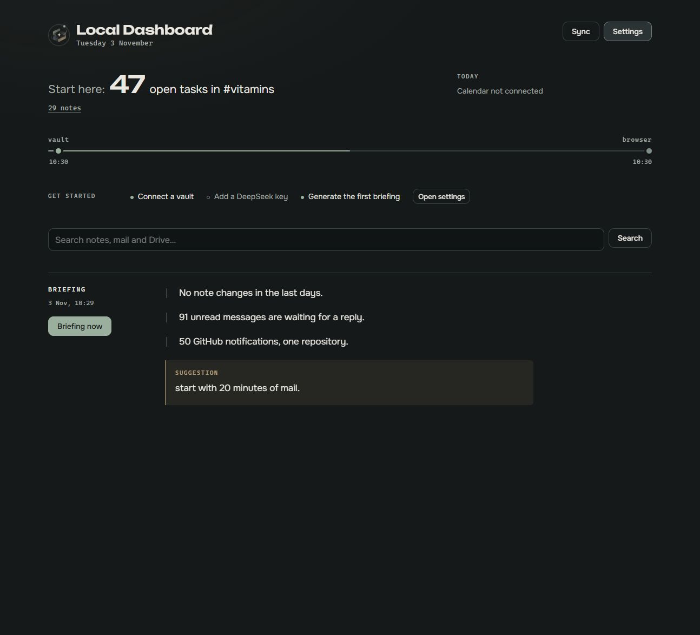
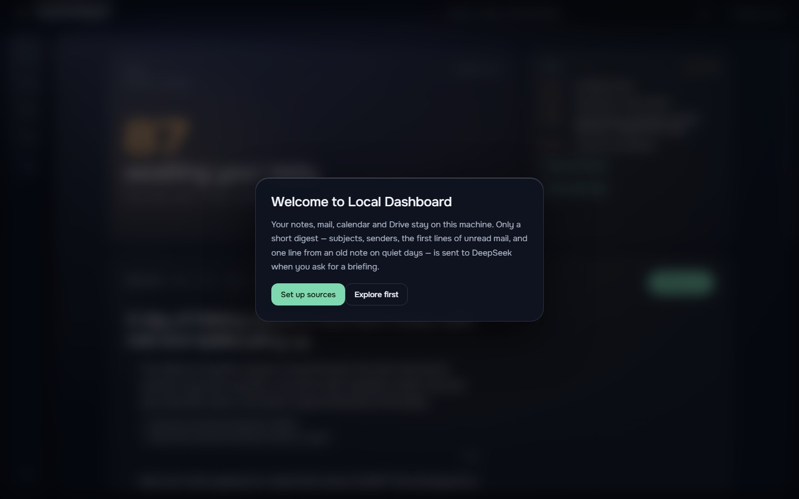
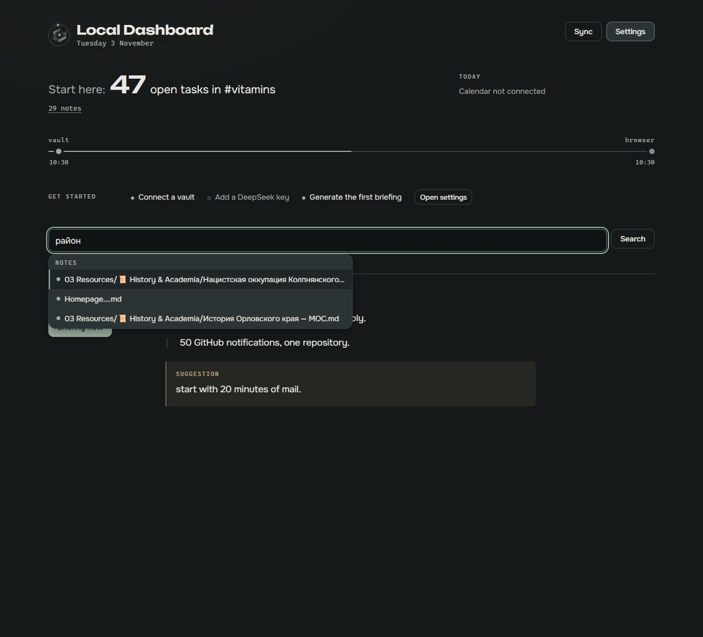
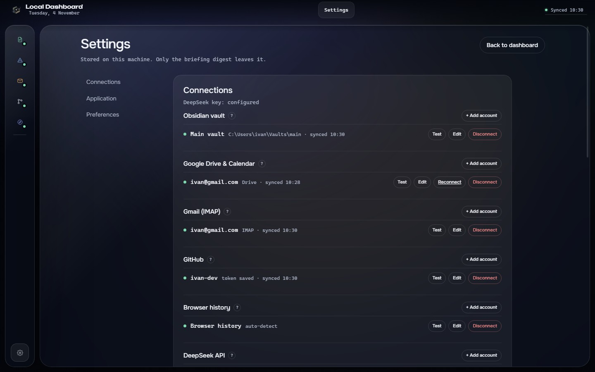

# Local Dashboard 1.18.0

**Phase 4 closes the loop: the release is now checked, measured and able to update itself.**

1.18.0 is a release-quality pass rather than a new source. It adds Playwright e2e and visual
regression checks, opt-in auto-update, opt-in code-signing configuration, and a performance and docs
pass. Nothing about the daily flow changes: sources stay optional, Local only still blocks every
outbound request, and the build remains unsigned by default.

## Highlights

- **Playwright e2e** — the zero-state, local-only and settings flows run under Playwright
  (`npm run test:e2e`), each isolated from shared state. A fresh data dir is created per run so the
  tests never touch real data.
- **Visual regression** — the dashboard, settings and search screens are pinned by screenshots
  (`npm run test:visual`) on a fixed clock and reduced motion, so an unintended UI drift fails the
  run. Baselines live in `e2e/__screenshots__/`.
- **Opt-in auto-update** — the packaged build checks GitHub Releases for a newer version at startup
  and every six hours, downloads in the background and asks before installing. It is skipped while
  **Local only** is on, can be turned off under **Settings → Application → Check for updates
  automatically**, and never runs in a source build.
- **Opt-in code signing** — `electron-builder` is configured with a trusted RFC 3161 timestamp server
  and SHA-256. Setting `CSC_LINK` / `CSC_KEY_PASSWORD` signs the build; nothing is signed unless a
  certificate is present, so builds stay unsigned by default. See `docs/SIGNING.md`.
- **Performance pass** — added a `calendar_events (connection_id, start)` index (the
  `teams_mentions_created` index was already present) and confirmed the Graph (5 pages), Teams (50
  chats) and CalDAV (100 recurring instances) caps. A cold sync of a 300-note vault measured ~73 ms
  and startup-to-ready ~0.6 s.

## Showcase

| | |
| --- | --- |
|  |  |
| Focus, source rail, today and the briefing | First run says what stays local |
|  |  |
| Command-field search with grouped suggestions | Connections, preferences and appearance |

The captures predate this release: the Settings → Application screen does not show the new **Check for
updates automatically** toggle. The layout they show is unchanged.

## Install

1. Download `Local-Dashboard-Setup-1.18.0.exe` below and run it.
2. SmartScreen may warn because the build is not code-signed: **More info → Run anyway**.
3. Start the app. Nothing is required; connect a source when you want one, and add a DeepSeek key only
   for the written briefing.

`Local-Dashboard-1.18.0.exe` is the portable build.

Upgrading from 1.17.0 keeps the database, connections and settings. Auto-update is on by default in
packaged builds; to opt out, open **Settings → Application** and clear **Check for updates
automatically**.

## Update behaviour

The packaged build checks the GitHub Releases provider (configured in `package.json`) for a newer
version at startup and every six hours. When one is found, it downloads in the background and shows a
native notification with **Download**, then **Restart and install**. Auto-update is opt-in:

- **Packaged only.** `electron-updater` is wired only when `app.isPackaged`; `npm run dev` and
  `npm run electron:dev` never check.
- **Skipped in Local only.** The pure `shouldCheckForUpdates(localOnly, autoUpdate)` policy returns
  false while Local only is on, so no update request leaves the machine.
- **Can be disabled.** The `auto_update` setting (Settings → Application → **Check for updates
  automatically**) turns it off; it is on by default.
- **Unsigned updates.** Downloaded updates are unsigned, like the installer, so the same SmartScreen
  confirmation applies.

## Signing status

The build is **unsigned by default**. Signing is opt-in: set `CSC_LINK` (path to a `.pfx`/`.p12`
file or its base64 encoding) and `CSC_KEY_PASSWORD` for the `dist` run, and `electron-builder` signs
the installer and portable build. The build already configures a trusted RFC 3161 timestamp server and
SHA-256. See `docs/SIGNING.md` for the certificate setup and how to verify a build with
`Get-AuthenticodeSignature`. This release was not signed; no certificate was used.

## Checks

- `npm run check`: typecheck clean, **342 tests passed** (44 files), production build OK.
- `npm run test:e2e`: zero-state, local-only and settings flows pass. The settings add/disable/remove
  flow runs against a local-only **Obsidian vault** connection pointed at an empty temp directory, so
  it is deterministic offline (no network source is exercised).
- `npm run test:visual`: dashboard, settings and search baselines pass on Windows.
- Installer SHA-512 is listed in `latest.yml` and verified against the built installer.

## Known limits

- **No live update-install smoke test.** Auto-update is verified through the pure
  `shouldCheckForUpdates` policy (unit-tested) and the release metadata; a real update was not
  downloaded and installed on a machine here.
- **Visual baselines are generated on Windows.** A different OS or font rendering may report false
  diffs in `npm run test:visual`.
- **No clean-VM packaged smoke test.** The installer and portable build are produced and their
  SHA-512 verified, but they were not exercised on a fresh Windows VM in this cycle.
- **The installer is not code-signed**, so SmartScreen asks for confirmation on first run and on
  each downloaded update.
